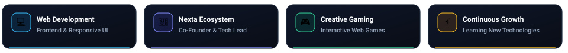

<div align="center">

<!-- Hero Banner -->
<a href="https://github.com/AhmedMohamed2009-lab">
  
</a>

<!-- Animated Ticker Marquee -->
<a href="https://github.com/AhmedMohamed2009-lab">
  
</a>

<br/>

<!-- Core Pillars / Highlights -->


</div>

<br/>

---

### 👨‍💻 About Me

```yaml
name: Ahmed Mohamed
alias: @tOlbaa
location: Egypt 🇪🇬
current_focus: Building modern web applications & interactive digital experiences
ventures: Co-Founder @ Nexta
interests: [Frontend Architecture, UI/UX Design, Web Games, Open Source]
```

- 🚀 **Co-Founder @ Nexta** — Leading and collaborating on modern web platforms and creative digital initiatives.
- 💡 **Passionate about Frontend Engineering** — Crafting responsive, intuitive, and accessible user interfaces.
- 🎮 **Game & Creative Coding Experimenter** — Developing browser-based arcade games like [Cube Fire](https://ahmedmohamed2009-lab.github.io/cube-fire/).
- 📈 **Continuous Learner** — Exploring modern JavaScript/TypeScript ecosystems, component architectures, and web performance.
- 🤝 **Open for Collaborations** — Eager to contribute to meaningful digital products and open-source projects.

<br/>

---

### 🛠️ Tech Stack & Tools

<div align="center">

#### Languages & Core Technologies
<p align="center">
  
</p>

#### Frameworks, Styling & Libraries
<p align="center">
  
</p>

#### Tools, Platforms & Workflow
<p align="center">
  
</p>

</div>

<br/>

---

### 🚀 Featured Projects & Nexta Ecosystem

<div align="center">
  
</div>

<br/>

| Project | Category | Description | Tech Stack | Links |
| :--- | :--- | :--- | :--- | :--- |
| **Carry-Chic** | 🛍️ E-Commerce | Modern online boutique for handmade bags featuring responsive catalogs and sleek browsing. | `HTML5` `CSS3` `JavaScript` | [🌐 Live Demo](https://ahmedmohamed2009-lab.github.io/Carry-Chic/carrychic.html) • [📂 Repo](https://github.com/AhmedMohamed2009-lab/Carry-Chic) |
| **Cube Fire** | 🎮 Web Game | Fast-paced browser arcade game built for real-time fun with friends. | `JavaScript` `Canvas` `CSS3` | [🎮 Play Game](https://ahmedmohamed2009-lab.github.io/cube-fire/) • [📂 Repo](https://github.com/AhmedMohamed2009-lab/cube-fire) |
| **Nexta Official** | 🚀 Digital Agency | Co-founded digital initiative and tech collective delivering creative web platforms. | `Web Architecture` `UI/UX` | [🌐 Live Site](https://mohamed-mma.github.io/Nexta/) |
| **Assrar Market** | 🛒 Marketplace | Collaborative digital storefront created under the Nexta brand in partnership with Mohamed Mahmoud. | `Web App` `Vercel` `Nexta` | [🛍️ Visit Store](https://assrar-market.vercel.app/) |
| **Nexta Link** | 🔗 Ecosystem Hub | Centralized portal connecting all Nexta projects, resources, and community touchpoints. | `Resource Hub` `Portal` | [🔗 Open Hub](https://mohamed-mma.github.io/Nexta-Link/) |

<br/>

---

### 📊 GitHub Activity & Metrics

<div align="center">

  
  

  <br/><br/>

  

</div>

<br/>

---

### 🐍 Contribution Graph

<div align="center">
  <picture>
    <source media="(prefers-color-scheme: dark)" srcset="https://raw.githubusercontent.com/AhmedMohamed2009-lab/AhmedMohamed2009-lab/output/github-contribution-grid-snake-dark.svg" />
    <source media="(prefers-color-scheme: light)" srcset="https://raw.githubusercontent.com/AhmedMohamed2009-lab/AhmedMohamed2009-lab/output/github-contribution-grid-snake.svg" />
    
  </picture>
</div>

<br/>

---

### 🌐 Connect With Me

<div align="center">

<a href="https://github.com/AhmedMohamed2009-lab" target="_blank">
  
</a>
&nbsp;
<a href="https://mohamed-mma.github.io/Nexta/" target="_blank">
  
</a>
&nbsp;
<a href="https://mohamed-mma.github.io/Nexta-Link/" target="_blank">
  
</a>

<br/><br/>

<sub>Crafted with passion • © Ahmed Mohamed</sub>

</div>
