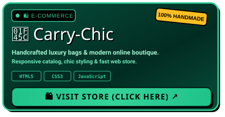
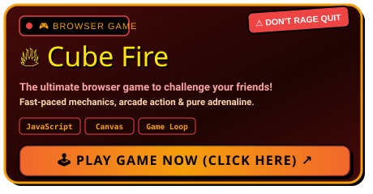
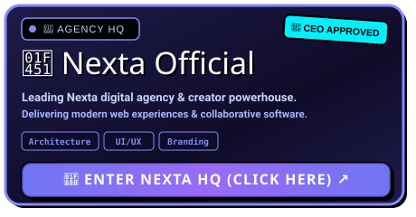
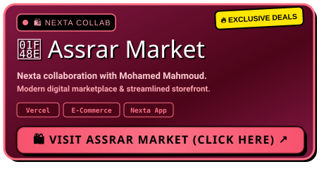
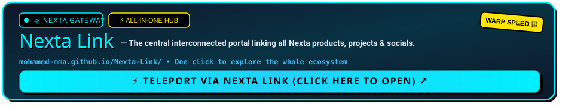

<div align="center">

<!-- Hero Arcade Banner with Animated Mascot & Quotes -->
<a href="https://github.com/AhmedMohamed2009-lab">
  
</a>

<!-- Funny Running Ticker -->
<a href="https://github.com/AhmedMohamed2009-lab">
  
</a>

</div>

<br/>

---

### 🕹️ Player 1 Stats & Bio

```yaml
Character: Ahmed Mohamed (@tOlbaa)
Class: Full-Stack Sorcerer / Junior SWE
Location: Cairo, Egypt 🇪🇬
Guild: Co-Founder & CEO @ Nexta 👔
Special_Ability: Turning caffeine & shawarma into working web apps 🧆☕
Current_Status: "Staring at CSS until it behaves itself."
```

- 👑 **CEO @ Nexta** — Leading the squad to build slick digital platforms and web ventures.
- 🎮 **Arcade Creator** — Built [Cube Fire](https://ahmedmohamed2009-lab.github.io/cube-fire/) to challenge my friends (and watch them rage quit).
- 💻 **Frontend Fanatic** — Crafting responsive UI, snappy animations, and interactive apps that don't look like they were made in 1998.
- 🐛 **Bug Exterminator** — I don't always test my code, but when I do, I do it in production *(just kidding, please don't fire me)*.
- 🤝 **Ready for Co-Op** — Got an exciting project or want to collab on something cool? Hit me up!

<br/>

---

### 🚀 Featured Creations & Nexta Empire
> **💡 Pro Tip:** Every banner below is fully interactive. Click anywhere on a banner to launch that site or game directly!

<div align="center">

<p align="center">
  <a href="https://ahmedmohamed2009-lab.github.io/Carry-Chic/carrychic.html" target="_blank">
    
  </a>
  &nbsp;
  <a href="https://ahmedmohamed2009-lab.github.io/cube-fire/" target="_blank">
    
  </a>
</p>

<p align="center">
  <a href="https://mohamed-mma.github.io/Nexta/" target="_blank">
    
  </a>
  &nbsp;
  <a href="https://assrar-market.vercel.app/" target="_blank">
    
  </a>
</p>

<p align="center">
  <a href="https://mohamed-mma.github.io/Nexta-Link/" target="_blank">
    
  </a>
</p>

</div>

<br/>

#### 📋 Quick Direct Links Table
| Project | Type | What is it? | Quick Action |
| :--- | :--- | :--- | :--- |
| **Carry-Chic** | 👜 E-Commerce | Handmade bags online boutique with smooth catalog UI | [🛍️ Visit Carry-Chic Store](https://ahmedmohamed2009-lab.github.io/Carry-Chic/carrychic.html) |
| **Cube Fire** | 🎮 Web Game | Fast-paced browser arcade game for friend battles | [🕹️ Play Cube Fire Game](https://ahmedmohamed2009-lab.github.io/cube-fire/) |
| **Nexta Official** | 🚀 Agency HQ | Official home of Nexta digital agency & creative collective | [🌐 Explore Nexta HQ](https://mohamed-mma.github.io/Nexta/) |
| **Assrar Market** | 🛒 Marketplace | Nexta collab with Mohamed Mahmoud for online commerce | [💎 Open Assrar Market](https://assrar-market.vercel.app/) |
| **Nexta Link** | 🛸 Portal Hub | One link to teleport to all Nexta projects & socials | [⚡ Launch Nexta Link](https://mohamed-mma.github.io/Nexta-Link/) |

<br/>

---

### ⚔️ Weapons of Choice (Tech Stack)

<div align="center">

#### ⚡ Core Languages
<p align="center">
  
</p>

#### 🎨 Styling & Frameworks
<p align="center">
  
</p>

#### 🛠️ Dev Tools & Environment
<p align="center">
  
</p>

</div>

<br/>

---

### 📊 Proof That I Actually Code (GitHub Stats)

<div align="center">

  
  

  <br/><br/>

  

</div>

<br/>

---

### 🐍 The Holy Contribution Snake

<div align="center">
  <picture>
    <source media="(prefers-color-scheme: dark)" srcset="https://raw.githubusercontent.com/AhmedMohamed2009-lab/AhmedMohamed2009-lab/output/github-contribution-grid-snake-dark.svg" />
    <source media="(prefers-color-scheme: light)" srcset="https://raw.githubusercontent.com/AhmedMohamed2009-lab/AhmedMohamed2009-lab/output/github-contribution-grid-snake.svg" />
    
  </picture>
</div>

<br/>

---

### 📫 Summon Me (Let's Connect!)

<div align="center">

<a href="https://github.com/AhmedMohamed2009-lab" target="_blank">
  
</a>
&nbsp;
<a href="https://mohamed-mma.github.io/Nexta/" target="_blank">
  
</a>
&nbsp;
<a href="https://mohamed-mma.github.io/Nexta-Link/" target="_blank">
  
</a>

<br/><br/>

```
      /\_/\  
     ( o.o )  "Thanks for dropping by! Now go play Cube Fire!"
      > ^ <
```

<sub>Built with ⚡ & caffeine by **Ahmed Mohamed (@tOlbaa)**</sub>

</div>
